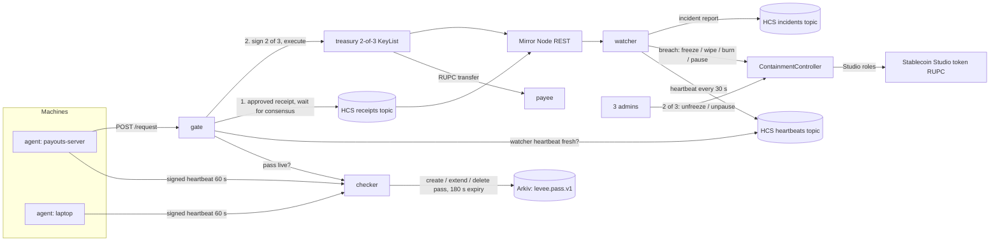

# Levee

[](https://github.com/0xvikram/levee/actions/workflows/test.yml)

Levee stops a stolen-key theft from a Hedera Stablecoin Studio treasury in about 10 seconds. It freezes the treasury, wipes and freezes the account that received the tokens, and writes a public incident record. Opening anything up again takes 2 of 3 admins.

Built for ETHGlobal Mumbai 2026. Main track: Hedera "Tokenize with Hedera Studios" (Stablecoin Studio). Also submitted to Arkiv "Build from scratch".

- Demo video: (link added at submission)
- Hosted dashboard: (URL added at deploy)
- Live testnet run log: [docs/LIVE_RUN.md](docs/LIVE_RUN.md)

## Problem

A stablecoin issuer's treasury key, or the server that holds it, is the single point of failure. When an attacker gets the key, the tokens move in one transaction and the issuer finds out from users or from a price chart.

| incident | when | what happened | source |
|---|---|---|---|
| Resolv USR | 22 Mar 2026 | Attacker minted ~80M unbacked USR and extracted ~$25M before the protocol was paused | [The Block](https://www.theblock.co/post/394582/resolvs-usr-stablecoin-depegs-after-attacker-mints-80-million-unbacked-tokens-extracts-roughly-25-million) |
| StablR (EURR, USDR) | 24 May 2026 | Minting multisig compromised; unbacked tokens issued; ~$2.8M extracted on-chain | [Cointelegraph](https://cointelegraph.com/news/euro-and-usd-stablecoins-depeg-amid-ongoing-28m-stablr-exploit) |
| Gala Games | 20 May 2024 | Compromised admin address minted 5B GALA (~$200M); the attacker sold ~$21M before the wallet was frozen | [The Block](https://www.theblock.co/post/295723/gala-games-exploiter-returns-21-million-taken-from-the-200-million-exploit) |

In each case the issuer had the power to freeze, but a human had to notice first. Levee makes the "notice and freeze" part automatic, and makes every legitimate move leave a public receipt first, so "unreceipted" is a precise, machine-checkable definition of theft.

## How it works

Four parts. Each one only does one job.

1. **Leash (machine passes on Arkiv).** Each company machine runs an agent that sends a signed heartbeat every 60 s with 7 read-only health checks. The checker keeps a pass for the machine on Arkiv that expires 180 s after the last good heartbeat. A failing check deletes the pass at once. A sleeping laptop just loses its pass. See [docs/LEASH.md](docs/LEASH.md).
2. **Gate (receipt before money).** A machine asks the gate to pay someone. The gate checks: live pass, per-transfer cap, daily cap, known destination, and a fresh watcher heartbeat. If all pass, it fixes the transaction id, writes an `approved` receipt with that id to an HCS topic, waits for consensus, and only then adds its signature as the 2nd of 3 treasury keys. Anything else is refused with a reason and no money moves.
3. **Watcher (match every movement).** The watcher reads every RUPC movement on the Mirror Node and matches it by transaction id to a receipt that reached consensus before it. A movement with no receipt, a receipt that came after it, a reused or mismatched receipt, a cap break, an unknown destination, or a new allowance on the treasury is a breach.
4. **ContainmentController (close only).** On a breach the watcher calls a small contract that holds the Studio freeze, wipe, burn and pause roles. It freezes the treasury, wipes and freezes the receiver, burns unauthorised supply, and optionally pauses the token. The watcher can only close things. Unfreeze, unpause and changing the watcher need 2 of the 3 admins. The incident (breach, each step, its tx id and timing) is published to an HCS topic.



## Hedera services used

| service | what Levee uses it for | file |
|---|---|---|
| Stablecoin Studio v4 | RUPC is a real Studio token from the testnet factory `0.0.7353542`; cash-in, freeze, wipe, burn, pause go through the Studio proxy and its role system | [src/setup/token.ts](src/setup/token.ts), [src/setup/studio.ts](src/setup/studio.ts) |
| HTS keys and Studio roles | The controller holds FREEZE, WIPE, BURN and PAUSE roles and never DEFAULT_ADMIN. The gate holds the cash-in role with an unlimited supplier allowance, so legitimate mints are gated too | [src/setup/controller.ts](src/setup/controller.ts) |
| HCS topics with submit keys | 3 topics. receipts: submit key = gate key. incidents and heartbeats: submit key = watcher key. No admin key, so nobody can change the submit key or delete a topic | [src/setup/topics.ts](src/setup/topics.ts), [src/shared/hcs.ts](src/shared/hcs.ts) |
| KeyList threshold account | The company treasury key is a 2-of-3 KeyList {treasurySigner, gate, cold}. Every normal payout needs the gate's signature, and the gate only signs after its receipt is on HCS | [src/setup/accounts.ts](src/setup/accounts.ts) |
| Transaction freezing (fixed tx id) | The gate freezes the transfer (SDK `freezeWith`) before writing the receipt, so the receipt names the exact tx id that will appear on chain | [src/gate/server.ts](src/gate/server.ts) |
| Mirror Node REST | Token movements per account, topic messages, freeze status, block lag (watcher fails closed above 20 s lag), free gas estimates and contract calls | [src/shared/mirror.ts](src/shared/mirror.ts), [src/watcher/watcher.ts](src/watcher/watcher.ts) |
| Smart contract (Hedera EVM) | `ContainmentController.sol`: close-only actions for the watcher, 2-of-3 proposals for anything that opens | [contracts/ContainmentController.sol](contracts/ContainmentController.sol) |
| JSON-RPC relay | Controller deploy through Hashio (EthereumTransaction, gas only) | [src/setup/controller.ts](src/setup/controller.ts) |

## Arkiv

Leash stores one pass per machine as an Arkiv entity (`levee.pass.v1`) owned by the checker wallet, with a 180 s lifetime and `permissionlessExtension: false`. Silence means no pass, without a revocation list or a cron job. The gate fails closed if Arkiv's latest block is 10 s or older.

- Why Arkiv: [arkiv/why-arkiv.md](arkiv/why-arkiv.md)
- Schema: [arkiv/schema.md](arkiv/schema.md)
- How we use it, with live entities: [arkiv/how-you-use-arkiv.md](arkiv/how-you-use-arkiv.md)
- Who else can use it: [arkiv/reach.md](arkiv/reach.md)
- Friction log: [arkiv/friction.md](arkiv/friction.md)

## Live on testnet

All IDs are on Hedera testnet, deployed 6 Nov 2026 (also in [dashboard/src/lib/config.ts](dashboard/src/lib/config.ts)).

| what | id |
|---|---|
| Token RUPC (Studio v4, 6 decimals) | [0.0.11333594](https://hashscan.io/testnet/token/0.0.11333594) |
| Studio factory | [0.0.7353542](https://hashscan.io/testnet/contract/0.0.7353542) |
| ContainmentController | [0.0.11333603](https://hashscan.io/testnet/contract/0.0.11333603) |
| Receipts topic (submit key: gate) | [0.0.11333498](https://hashscan.io/testnet/topic/0.0.11333498) |
| Incidents topic (submit key: watcher) | [0.0.11333500](https://hashscan.io/testnet/topic/0.0.11333500) |
| Heartbeats topic (submit key: watcher) | [0.0.11333501](https://hashscan.io/testnet/topic/0.0.11333501) |
| Company treasury (2-of-3 KeyList) | [0.0.11333495](https://hashscan.io/testnet/account/0.0.11333495) |
| Payees | [0.0.11333490](https://hashscan.io/testnet/account/0.0.11333490), [0.0.11333492](https://hashscan.io/testnet/account/0.0.11333492) |
| Demo attacker | [0.0.11333494](https://hashscan.io/testnet/account/0.0.11333494) |
| Admins | [0.0.11333483](https://hashscan.io/testnet/account/0.0.11333483), [0.0.11333484](https://hashscan.io/testnet/account/0.0.11333484), [0.0.11333485](https://hashscan.io/testnet/account/0.0.11333485) |

## Measured results

All runs on testnet, 6 Nov 2026. Raw numbers are in [docs/LIVE_RUN.md](docs/LIVE_RUN.md) and the incident messages on topic [0.0.11333500](https://hashscan.io/testnet/topic/0.0.11333500).

### Stolen-key drain (the attack bypasses the gate with 2 of the 3 treasury keys)

Times are measured from the theft's consensus timestamp. "Watcher" columns are the watcher's own clock when each step's receipt came back (as published in the incident). "Consensus" columns are the containment transaction's consensus timestamp on the Mirror Node.

| run | amount | detected (watcher) | treasury frozen (watcher / consensus) | receiver wiped + frozen (watcher / consensus) | txs |
|---|---|---|---|---|---|
| **latest run** (receipt grace on) | 1,000 RUPC | 6.89 s | 9.44 s / 8.28 s | 10.72 s / 10.17 s | [theft](https://hashscan.io/testnet/transaction/0.0.11333495-1793940607-721315934) · [freeze](https://hashscan.io/testnet/transaction/0.0.11333487-1793940615-613691402) · [wipe](https://hashscan.io/testnet/transaction/0.0.11333487-1793940618-278571902) |
| first full run (before the grace) | 10,000 RUPC | 4.19 s | 6.44 s / 5.48 s | 8.31 s / 7.22 s | [theft](https://hashscan.io/testnet/transaction/0.0.11333495-1793935170-233904996) · [freeze](https://hashscan.io/testnet/transaction/0.0.11333487-1793935173-898405003) · [wipe](https://hashscan.io/testnet/transaction/0.0.11333487-1793935180-013412119) |

The latest run is slower because the watcher now waits up to 3 s for a receipt the Mirror Node has not served yet (see Design decisions). The latest run was reopened 2 of 3 afterwards: treasury [propose](https://hashscan.io/testnet/transaction/0.0.11333483-1793940640-406300935) / [approve](https://hashscan.io/testnet/transaction/0.0.11333484-1793940644-187266580), attacker [propose](https://hashscan.io/testnet/transaction/0.0.11333483-1793940643-925485422) / [approve](https://hashscan.io/testnet/transaction/0.0.11333484-1793940645-297104239).

### Normal payouts and false alarms

| run | payouts | matched | breaches | notes |
|---|---|---|---|---|
| A (before the grace) | 100 planned | 5 | 1 false alarm | Receipt reached consensus 0.88 s before the transfer, but one Mirror replica had not served it yet. Containment then froze the treasury, so 94 later transfers failed |
| B (grace on) | 100 | 100 | 0 | 42,595 RUPC moved in 376 s |
| C (grace on) | 193 of 300 | 193 | 0 | 3 matches needed the grace. The Mac slept after 193; the other 107 were refused `no-pass` (pass expired), as designed |

| metric | value | source |
|---|---|---|
| Gate latency (request to signed transfer) | p50 3.66 s (run B), 3.47 s (run C) | LIVE_RUN.md §2 |
| Watcher match after the gate's reply | p50 2.2 s, p95 4.0 s (B) / 3.7 s (C) | LIVE_RUN.md §2 |
| Fee per gated payout | ≈ 0.020 HBAR (0.016 transfer + 0.004 receipt) | LIVE_RUN.md, Budget |
| Fee per containment | ≈ 0.23 HBAR (freeze 0.096 + wipe+freeze 0.138, latest run) | Mirror Node `charged_tx_fee` |
| Gate throughput (one gate, serial) | ≈ 0.27 payouts/s (100 in 376 s) | LIVE_RUN.md run B |
| Mirror visibility after consensus | median 2.95 s over 3 runs | [docs/FIRST_HOUR_TESTS.md](docs/FIRST_HOUR_TESTS.md) T4 |
| Unit tests | 272 root (incl. controller EVM tests) + 78 dashboard, no network or keys | `npx vitest run`, CI |

Gate refusals seen live (no money moves, no receipt written): `no-pass` (laptop failing the remote-access check, 347 ms), `over-transfer-cap` (669 ms), `unknown-destination` (969 ms), `no-pass` for a never-enrolled machine (20 ms).

## Design decisions

- **Call the Studio factory directly.** The Studio SDK's `StableCoin.create()` always sends 80 HBAR and a 10M gas limit. `src/setup/token.ts` builds the same request and calls the factory's `deployStableCoin` with a Mirror Node gas estimate (+15%). The token is a normal Studio token; any Studio tooling can manage it.
- **Containment order: freeze treasury, then wipe → freeze receiver, then burn, then pause.** The treasury goes first to stop further outflows. Hedera refuses to wipe a frozen account (`ACCOUNT_FROZEN_FOR_TOKEN`, test T2), so the controller wipes before it freezes, in one transaction; for an already frozen account `wipeFrozen` unfreezes, wipes and refreezes atomically. A paused token rejects freeze, wipe and burn (`TOKEN_IS_PAUSED`, test T3), so pause is always last and off by default (`PAUSE_ON_BREACH`).
- **Close-only watcher.** The watcher key can freeze, wipe, burn and pause. It cannot unfreeze, unpause or replace itself; those need 2 of 3 admins on the controller. A stolen watcher key can cause an outage, not a theft.
- **Receipt grace for Mirror replicas.** Run A raised a false alarm because the public Mirror Node is served by replicas that can disagree by about 1 s. A movement whose only fault is "no receipt yet" now waits up to `WATCHER_RECEIPT_GRACE_MS` (3 s), and is judged at once if the receipts read already contains a later message. The receipt must still have reached consensus before the movement.
- **Fail closed everywhere.** No pass, Arkiv block older than 10 s, watcher heartbeat older than 120 s, or Mirror lag above 20 s: the gate refuses. A sleeping machine is reported `offline`, never as a breach.
- **Machine profiles fixed at enrolment.** `laptop` runs all 7 checks; `server` and `ci` skip disk, extensions and remote-access. A machine cannot switch profile later to skip checks.
- **Receipt before signature, by tx id.** The gate fixes the transaction id first, so the receipt and the transfer refer to the same id and the watcher's match is exact, not heuristic.

## Quick start

Needs Node 20+ (CI uses 24), a Hedera testnet account from [portal.hedera.com](https://portal.hedera.com), and a funded Arkiv Rabdi wallet ([hub.arkiv.network](https://hub.arkiv.network)).

```sh
npm ci
cp .env.example .env          # OPERATOR_ID, OPERATOR_KEY, ARKIV_PRIVATE_KEY, ARKIV_ACCESS_KEY, caps
npm run setup                 # accounts -> topics -> Studio token -> controller (skips what exists)
npm run setup:status          # what is left + operator balance
npm run t1 && npm run t2 && npm run t3 && npm run t4   # live role, wipe-order, pause, timing tests

scripts/demo/up.sh            # checker (Arkiv) -> agents -> watcher -> gate; keeps the Mac awake
npx tsx scripts/demo/normal-path.ts          # 1 approved payout + 3 refusals
npx tsx scripts/demo/normal-load.ts 100      # false-alarm test: asserts matched == N, breaches == 0
npx tsx scripts/attack.ts 1000               # stolen 2-of-3 keys drain 1,000 RUPC around the gate
npx tsx scripts/reopen.ts treasury attacker  # 2-of-3 admins unfreeze after the incident
scripts/demo/down.sh

cd dashboard && npm ci && npm run dev        # landing + /live control room on :5173
DEMO_MODE=1 npm run demo:runner              # (repo root) lets the dashboard run pay / attack / reopen; 127.0.0.1 only
```

`state/` holds keys and deployment output and is gitignored. Tests: `npx vitest run` (root) and `cd dashboard && npx vitest run`. API reference: [docs/API.md](docs/API.md).

## Network impact (projection)

Per company that adopts Levee, from the setup plan in `src/setup/plan.ts`:

- New accounts: 6 (3 admins, watcher, gate, 2-of-3 treasury), plus one association per payee.
- Other entities: 3 HCS topics, 1 Studio token (or an existing one), 1 contract.
- Per payout: 2 transactions (1 HCS receipt + 1 HTS transfer).
- Watcher heartbeats: 1 HCS message every 30 s = 2,880 per day per watcher.
- Per incident: 2 to 4 contract calls + 1 HCS incident message.

Worked example, labelled as a projection, not traction: a payout fintech doing 1,000 payouts a day would add 2,000 payout transactions plus 2,880 heartbeats, about 4,880 transactions a day (≈ 146,000 a month). At the measured ≈ 0.020 HBAR per payout, fees for the payouts alone are about 20 HBAR a day. Ten such companies would add 60 accounts and about 1.5M transactions a month.

## Mainnet readiness

- **Dedicated Mirror Node and gRPC.** The public Mirror Node has replica lag and rate limits. Production should use a paid or self-hosted Mirror Node (or a Mirror gRPC topic subscription) so the receipt grace can go to near 0.
- **Keys in KMS or HSM.** Gate, watcher, admin and treasury keys are files in `state/` for the demo. On mainnet they belong in a KMS/HSM with per-key policies; the cold treasury key stays offline.
- **Audit.** `ContainmentController.sol` has not been audited.
- **Gate throughput.** One gate is serial and measured at ≈ 0.27 payouts/s (p50 3.66 s each, most of it HCS consensus and transfer execution). To scale: run several gates, each with its own pre-assigned daily budget and destination set, or batch several payouts into one receipt and one multi-party transfer. The watcher is read-only and not the bottleneck.
- **Fees.** ≈ 0.020 HBAR per payout and ≈ 0.23 HBAR per containment on testnet. HCS and HTS fees are fixed in USD on Hedera, so the cost per payout does not swing with token price.

## Known limits

- One Mac played both demo machines (`payouts-server` and `laptop-vikram`); only macOS checks exist.
- The heartbeat checks are read-only user-space checks. A root-level attacker on the machine can lie to them; the pass only raises the bar.
- Containment is fast but not instant: the stolen tokens sit in the receiving account for ~8 to 10 s. If the attacker moves them on inside that window, the wipe takes only what is left and the receiver is frozen; onward hops are not followed yet (`src/watcher/contain.ts`).
- The public Mirror Node is the only data source; when it lags over 20 s the gate stops all payouts.
- Run C did not reach 300 transfers (the Mac slept). The 300 run was not repeated.
- One token, one treasury, one gate per deployment.

## Roadmap

1. Attach to existing Studio tokens: grant the controller the four roles on any Studio token, no redeploy ([docs/BUSINESS.md](docs/BUSINESS.md)).
2. Mirror gRPC subscription for the watcher; target detection under 3 s.
3. Windows and Linux agents; MDM-signed baselines.
4. Several gates with split budgets; batched receipts.
5. Audit of the controller; KMS key support.
6. Hosted watcher for Studio issuers who do not want to run infrastructure.

## AI use

Built with Claude Code by Anthropic, which wrote most of the code, tests and docs under review. Images and videos on the landing page were generated with Google Flow / Veo; their watermark is kept. Human decisions by Vikram Singh: the idea, the track choices, the design direction, and review of what was built.

## Team

Vikram Singh.

## License

MIT, see [LICENSE](LICENSE).
