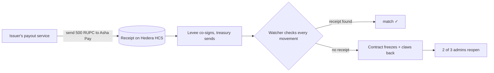
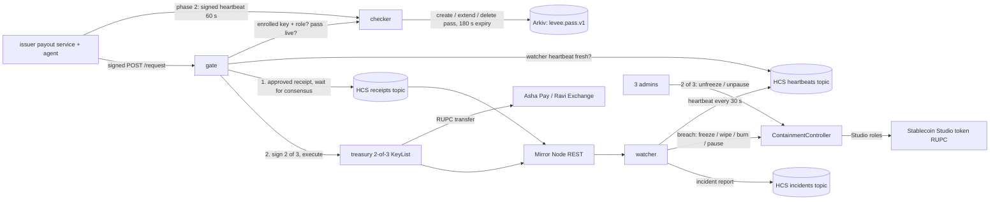

# Levee

[](https://github.com/0xvikram/levee/actions/workflows/test.yml)

**No receipt, no movement.**

Levee is a circuit breaker for stablecoin issuers on Hedera. Every token that leaves the issuer's treasury must have a receipt on Hedera first. If tokens move without one — stolen keys, a rogue insider — Levee freezes the treasury and takes them back in about seven seconds, and only 2 of 3 admins can reopen. The same rule covers mints: tokens minted with a stolen minting key and no receipt are wiped from the receiver, live on testnet in 7.53 s.

**For:** stablecoin issuers on Hedera, specifically the issuer's treasury and ops team. Taking tokens back needs the token's own freeze and wipe keys, which only the issuer holds (Hedera Stablecoin Studio gives them).

Built for ETHGlobal Mumbai 2026. Main track: Hedera "Tokenize with Hedera Studios" (Stablecoin Studio). Also submitted to Arkiv "Build from scratch".

- Demo video: (link added at submission)
- Hosted dashboard: https://levee-theta.vercel.app (live view: https://levee-theta.vercel.app/live, reads the chain directly)
- What it does and does not do, phase by phase: [docs/SCOPE.md](docs/SCOPE.md)
- Live testnet run log: [docs/LIVE_RUN.md](docs/LIVE_RUN.md)
- The 60-second pitch and demo script: [docs/PITCH.md](docs/PITCH.md)

## The example

A rupee stablecoin issuer runs token RUPC ([0.0.11333594](https://hashscan.io/testnet/token/0.0.11333594), live on testnet). Its treasury sends RUPC to its distributors and partners: Asha Pay (distributor, [0.0.11333490](https://hashscan.io/testnet/account/0.0.11333490)) and Ravi Exchange (partner, [0.0.11333492](https://hashscan.io/testnet/account/0.0.11333492)).



## The story in three steps

**1. Send 500 RUPC to Asha Pay ✓.** The issuer's payout service signs the request with its own enrolled machine key and asks Levee. Levee checks the signature and the machine's role, writes the receipt on Hedera, waits for consensus, then adds its signature as one of the two treasury keys the payment needs. The watcher sees the transfer, finds its receipt, and marks it ✓. In live runs: 393 of 393 payments matched with no false alarm (runs B, C and D, after the Mirror read fixes in [Design decisions](#design-decisions)), at about 0.02 HBAR per payment. One more signed payment after request signing went live also matched ([receipt](https://hashscan.io/testnet/transaction/0.0.11333489-1793975149-637916107) · [transfer](https://hashscan.io/testnet/transaction/0.0.11333495-1793975150-172921070)); it is not counted in the 393.

**2. A theft, frozen and clawed back.** Someone with the treasury's keys sends RUPC straight out without asking Levee. The watcher sees tokens leave with no receipt. The close-only contract freezes the treasury, wipes the tokens from the receiving account, and freezes that account. The incident is logged on Hedera. If the receiver is a known partner (Asha Pay, Ravi Exchange), it is frozen but never wiped ("known partner: frozen, not wiped; admins decide"), because a false alarm must not take a real partner's money; only unknown receivers are wiped. That rule came from run A's false alarm, which wiped Asha Pay before the fix (commit `3c9bb93`).

| run | stolen | detected | treasury frozen | taken back + receiver frozen | on HashScan |
|---|---|---|---|---|---|
| first full run | 10,000 RUPC | 4.19 s | 6.44 s | 8.31 s | [theft](https://hashscan.io/testnet/transaction/0.0.11333495-1793935170-233904996) · [freeze](https://hashscan.io/testnet/transaction/0.0.11333487-1793935173-898405003) · [wipe](https://hashscan.io/testnet/transaction/0.0.11333487-1793935180-013412119) |
| latest run | 1,000 RUPC | 2.87 s | 4.85 s | 6.86 s | [theft](https://hashscan.io/testnet/transaction/0.0.11333495-1793942673-449451952) · [freeze](https://hashscan.io/testnet/transaction/0.0.11333487-1793942676-864043046) · [wipe](https://hashscan.io/testnet/transaction/0.0.11333487-1793942678-498951813) |
| stolen minting key | 5,000 RUPC minted, no receipt | 4.65 s | not frozen (a mint is not a treasury outflow) | 7.53 s | [mint](https://hashscan.io/testnet/transaction/0.0.11333489-1793975099-404424918) · [wipe](https://hashscan.io/testnet/transaction/0.0.11333487-1793975101-804305541) · [retry bounced](https://hashscan.io/testnet/transaction/0.0.11333489-1793975151-294777090) |

Times are seconds after the theft reached consensus, on the watcher's clock (consensus times and a third run are under [Measured results](#measured-results)). Incident log: topic [0.0.11333500](https://hashscan.io/testnet/topic/0.0.11333500); the drain is message 5, the mint is message 7. After the mint was wiped, total supply was back at its pre-mint value and the attacker's retry failed with `ACCOUNT_FROZEN_FOR_TOKEN`. "Taken back" is an HTS wipe: the tokens leave the receiver's account and total supply drops by that amount.

**3. Reopen with 2 of 3 admins.** The contract and the watcher can close things but never reopen them. The latest run was reopened this way: treasury [propose](https://hashscan.io/testnet/transaction/0.0.11333483-1793942707-749023249) / [approve](https://hashscan.io/testnet/transaction/0.0.11333484-1793942710-022256943).

## Protects against / doesn't

| ✅ protects against | ❌ does not |
|---|---|
| Stolen treasury keys used outside the process | USDC or any token you did not issue |
| An insider moving tokens outside the process | A theft while the watcher is down (reported after restart, not undone) |
| A stolen minting (cash-in) key minting without a receipt (wiped + receiver frozen, live) | A second mint with the same stolen key (the key keeps its role; revoking it or pausing is not automatic yet) |
| Receipts that do not match the movement (amount, recipient, reused, written after) | An approved payment to the wrong recipient |
| Payments while the watcher is down (the gate refuses them all) | 2 of 3 admins colluding |
| Payment requests not signed by an enrolled machine with an allowed role (refused at the gate) | A root-level attacker on the requesting machine (it holds that machine's key) |

Partial cases (onward hops, repeat mints) and the evidence for each line: [docs/SCOPE.md](docs/SCOPE.md#threats).

## Phases

| phase | status | what | hard limits |
|---|---|---|---|
| 1. The product | Built, live on testnet | Treasury outflow without a prior receipt → freeze treasury, wipe + freeze an unknown receiver (a known partner is frozen only); mint without a receipt → wipe + freeze the receiver; 2-of-3 reopen | Studio tokens you issue only; one token, one treasury; takes back only what is still in the receiver's account; a theft while the watcher is down is not undone; receipted payments are trusted; a stolen minting key can mint again |
| 2. Stricter rules | Built, always on in today's code (caps set in `.env`; there is no switch yet) | Signed requests from enrolled machines with an allowed role, caps per payment and per day, known recipients only, machine-health pass on Arkiv for the service that requests payments | Health checks macOS only and self-reported by the machine's agent |
| 3. Roadmap | Not built | Custodian/MPC approval callback, automatic CASHIN revoke or pause after an unauthorised mint, burn of unauthorised supply left in the token treasury run live (unit-tested only), an on-chain partner guard in the controller, several tokens and treasuries, dedicated Mirror Node, KMS/HSM keys, audit, mainnet | — |

Details, settings and what each phase cannot do: [docs/SCOPE.md](docs/SCOPE.md).

## Problem

A stablecoin issuer's treasury key, or the server that holds it, is the single point of failure. When an attacker gets the key, the tokens move in one transaction and the issuer finds out from users or from a price chart.

| incident | when | what happened | time to contain | source |
|---|---|---|---|---|
| Resolv USR | 22 Mar 2026 | Attacker minted ~80M unbacked USR and extracted ~$25M before the protocol was paused | ~2 h 55 min to pause ([KuCoin News, post-mortem](https://www.kucoin.com/news/flash/resolv-postmortem-reveals-25m-crypto-drain-via-credential-exploitation)) | [The Block](https://www.theblock.co/post/394582/resolvs-usr-stablecoin-depegs-after-attacker-mints-80-million-unbacked-tokens-extracts-roughly-25-million) |
| StablR (EURR, USDR) | 24 May 2026 | Minting multisig compromised; unbacked tokens issued; ~$2.8M extracted on-chain | ~8 h before the issuer responded ([The Block](https://theblock.co/post/402429/stablrs-eurr-and-usdr-depeg-after-attacker-mints-13-5-million-in-unbacked-tokens-through-multisig-exploit)) | [Cointelegraph](https://cointelegraph.com/news/euro-and-usd-stablecoins-depeg-amid-ongoing-28m-stablr-exploit) |
| Gala Games | 20 May 2024 | Compromised admin address minted 5B GALA (~$200M); the attacker sold ~$21M before the wallet was frozen | ~45 min, by Gala's own account ([CryptoSlate](https://cryptoslate.com/gala-games-says-it-resolved-exploit-within-45-minutes-identified-culprit/)) | [The Block](https://www.theblock.co/post/295723/gala-games-exploiter-returns-21-million-taken-from-the-200-million-exploit) |

All three were key or admin compromises, and in each the response (pause, freeze, burn) came after people noticed, from 45 minutes to about 8 hours later. Levee makes the "notice and contain" part automatic, and makes every legitimate move leave a public receipt first, so "unreceipted" is a precise, machine-checkable definition of theft. It covers treasury transfers and, since the live mint run in [docs/LIVE_RUN.md](docs/LIVE_RUN.md) §5, mints sent to an account (detected and wiped in 7.53 s on testnet). Not automatic yet: stopping the stolen minting key from minting again, and burning unauthorised supply left in the token treasury (unit-tested only).

## How Levee differs

| tool | what it does | when it acts | automatic? | Hedera | source |
|---|---|---|---|---|---|
| Fireblocks policy engine + API co-signer | Approves or rejects a transaction against policy before it is signed | Before signing | Yes | HTS supported since July 2026 | [Fireblocks](https://support.fireblocks.io/hc/en-us/articles/28597075509788-Hedera-Native-Tokens-HTS-are-now-supported-July-2026) |
| Hypernative | Detects threats and can trigger an automated pause | At detection | Yes | No Hedera support found | [Hypernative](https://hypernative.io/industry/issuers) |
| OpenZeppelin Defender | Monitoring and automated actions | — | — | Hosted service retired 1 Jul 2026 | [OpenZeppelin](https://www.openzeppelin.com/news/defender-sunset-faq) |
| Circle / Tether blacklists | Freeze an address | After people notice | Manual | USDC on Hedera (0.0.456858) has a freeze key but no wipe key | [Mirror Node](https://mainnet-public.mirrornode.hedera.com/api/v1/tokens/0.0.456858) |
| Stablecoin Studio | Gives the issuer the token's roles (cash-in, freeze, wipe, burn, pause) | — | No monitoring | Native | [hashgraph/stablecoin-studio](https://github.com/hashgraph/stablecoin-studio) |
| **Levee** | Checks every ledger movement against a receipt written before it, and reverses what has none (freeze, wipe) | After the move, ~7 s on testnet | Yes | Testnet, Studio tokens | [docs/LIVE_RUN.md](docs/LIVE_RUN.md) |

Levee is not a replacement for a pre-signing policy engine. It works alongside one such as Fireblocks as a second line: the policy engine stops bad requests that pass through it; Levee catches what was signed outside it (a stolen quorum, an insider) and undoes it.

Why issuers and not everyone: claw-back needs the token's own freeze and wipe keys. Only the issuer has them. Levee cannot protect USDC or any token you do not issue.

## How it works in depth

In the code, the issuer's payout service is a machine (for example `payouts-server`) that calls the gate, and "Levee" is the gate plus the watcher and the contract.

Three parts make phase 1, plus the phase-2 add-ons. Each one only does one job.

1. **Gate (receipt before movement).** The payout service asks the gate to send, for example, 500 RUPC to Asha Pay (`npm run request -- --machine payouts-server --to 0.0.11333490 --amount 500`). The request is signed with that machine's enrolled key (EIP-191 over canonical JSON `{machine,to,amount,kind,nonce,sentAt}`). The gate first checks who is asking: the machine is enrolled, the signature recovers to its enrolled key, `sentAt` is within 60 s, the nonce is new, and the machine's role is allowed (`GATE_ALLOWED_ROLES`, default `finance,payouts`). Then it checks the phase-2 rules (live pass, per-transfer cap, daily cap, known recipient) and a fresh watcher heartbeat. If all pass, it fixes the transaction id, writes an `approved` receipt with that id to an HCS topic, waits for consensus, and only then adds its signature to the treasury's 2-of-3 KeyList. Anything else is refused with a reason and nothing moves.
2. **Watcher (match every movement).** The watcher reads every RUPC movement on the Mirror Node and matches it by transaction id to a receipt that reached consensus before it. A movement with no receipt, a receipt that came after it, a reused or mismatched receipt, a cap break, an unknown recipient, or a new allowance on the treasury is a breach.
3. **ContainmentController (close only).** On a breach the watcher calls a small contract that holds the Studio freeze, wipe, burn and pause roles. It freezes the treasury (only when tokens left it), wipes and freezes an unknown receiver, only freezes a known partner (admins decide), burns unauthorised supply left in the token treasury (unit-tested, not run live), and optionally pauses the token. The watcher can only close things. Unfreeze, unpause and changing the watcher need 2 of the 3 admins. The incident (breach, each step, its tx id and timing) is published to an HCS topic.
4. **Phase 2: Leash (health pass on Arkiv).** The payout service's machine runs an agent that sends a signed heartbeat every 60 s with 7 read-only health checks (macOS). The checker keeps a pass for the machine on Arkiv that expires 180 s after the last good heartbeat. A failing check deletes the pass at once; a machine that goes offline just loses it. The same machine key signs its payment requests, so a gate request is only accepted from the machine whose pass it is. Enrolment (`POST /enrol`) is locked by a per-run `ENROL_TOKEN`. See [docs/LEASH.md](docs/LEASH.md).



## Hedera services used

| service | what Levee uses it for | file |
|---|---|---|
| Stablecoin Studio v4 | RUPC is a real Studio token from the testnet factory `0.0.7353542`; cash-in, freeze, wipe, burn, pause go through the Studio proxy and its role system | [src/setup/token.ts](src/setup/token.ts), [src/setup/studio.ts](src/setup/studio.ts) |
| HTS keys and Studio roles | The controller holds FREEZE, WIPE, BURN and PAUSE roles and never DEFAULT_ADMIN. The gate holds the cash-in role with an unlimited supplier allowance, so legitimate mints are gated too | [src/setup/controller.ts](src/setup/controller.ts) |
| HCS topics with submit keys | 3 topics. receipts: submit key = gate key. incidents and heartbeats: submit key = watcher key. No admin key, so nobody can change the submit key or delete a topic | [src/setup/topics.ts](src/setup/topics.ts), [src/shared/hcs.ts](src/shared/hcs.ts) |
| KeyList threshold account | The company treasury key is a 2-of-3 KeyList {treasurySigner, gate, cold}. Every normal treasury transfer needs the gate's signature, and the gate only signs after its receipt is on HCS | [src/setup/accounts.ts](src/setup/accounts.ts) |
| Transaction freezing (fixed tx id) | The gate freezes the transfer (SDK `freezeWith`) before writing the receipt, so the receipt names the exact tx id that will appear on chain | [src/gate/server.ts](src/gate/server.ts) |
| Mirror Node REST | Token movements per account, topic messages, freeze status, block lag (watcher fails closed above 20 s lag), free gas estimates and contract calls | [src/shared/mirror.ts](src/shared/mirror.ts), [src/watcher/watcher.ts](src/watcher/watcher.ts) |
| Smart contract (Hedera EVM) | `ContainmentController.sol`: close-only actions for the watcher, 2-of-3 proposals for anything that opens | [contracts/ContainmentController.sol](contracts/ContainmentController.sol) |
| JSON-RPC relay | Controller deploy through Hashio (EthereumTransaction, gas only) | [src/setup/controller.ts](src/setup/controller.ts) |

## Phase 2 rules and Arkiv

The receipt rule is the product. On top of it the gate runs stricter checks; if any fails, Levee refuses to sign and writes no receipt. All of them are always on in today's code; the caps are set in `.env`, and there is no switch to turn a check off yet. Phase 1 does not depend on them.

- **Signed requests from an allowed machine:** every send request is signed by the requesting machine's enrolled key and must be fresh (60 s) and never replayed. The machine's enrolled role must be in `GATE_ALLOWED_ROLES` (default `finance,payouts`): in the demo `payouts-server` has role `payouts` and is allowed, `laptop-vikram` has role `employee` and is refused `wrong-role`. Unsigned, forged, stale or replayed requests are refused (`bad-signature`, `unknown-machine`, `stale-request`, `replayed-request`).
- **Caps:** a limit per payment and per day (`CAP_PER_TRANSFER`, `CAP_PER_DAY`).
- **Known recipients only:** RUPC can only go to the recipient list set at setup (Asha Pay, Ravi Exchange).
- **Machine-health pass on Arkiv (the "Leash"):** the service that requests payments must be healthy and online. Its pass lives on Arkiv and expires in 3 minutes unless renewed. Limits: macOS checks only, and they are self-reported by the machine's own agent.

One safety check is always on and is part of phase 1: Levee will not sign if the watcher has not checked in on Hedera for 2 minutes (no watcher, no payments).

Arkiv (secondary track) stores one pass per machine as an Arkiv entity (`levee.pass.v1`) owned by the checker wallet, with a 180 s lifetime and `permissionlessExtension: false`. Silence means no pass, without a revocation list or a cron job. The gate fails closed if Arkiv's latest block is 10 s or older.

- Why Arkiv: [arkiv/why-arkiv.md](arkiv/why-arkiv.md)
- Schema: [arkiv/schema.md](arkiv/schema.md)
- How we use it, with live entities: [arkiv/how-you-use-arkiv.md](arkiv/how-you-use-arkiv.md)
- Who else can use it: [arkiv/reach.md](arkiv/reach.md)
- Friction log: [arkiv/friction.md](arkiv/friction.md)

## Live on testnet

All IDs are on Hedera testnet, deployed 6 Nov 2026 (also in [dashboard/src/lib/config.ts](dashboard/src/lib/config.ts)).

| what | id |
|---|---|
| Token RUPC (Studio v4, 6 decimals) | [0.0.11333594](https://hashscan.io/testnet/token/0.0.11333594) |
| Studio factory | [0.0.7353542](https://hashscan.io/testnet/contract/0.0.7353542) |
| ContainmentController | [0.0.11333603](https://hashscan.io/testnet/contract/0.0.11333603) |
| Receipts topic (submit key: gate) | [0.0.11333498](https://hashscan.io/testnet/topic/0.0.11333498) |
| Incidents topic (submit key: watcher) | [0.0.11333500](https://hashscan.io/testnet/topic/0.0.11333500) |
| Heartbeats topic (submit key: watcher) | [0.0.11333501](https://hashscan.io/testnet/topic/0.0.11333501) |
| Issuer treasury (2-of-3 KeyList) | [0.0.11333495](https://hashscan.io/testnet/account/0.0.11333495) |
| Recipients (allowlisted) | Asha Pay, distributor [0.0.11333490](https://hashscan.io/testnet/account/0.0.11333490); Ravi Exchange, partner [0.0.11333492](https://hashscan.io/testnet/account/0.0.11333492) |
| Demo attacker | [0.0.11333494](https://hashscan.io/testnet/account/0.0.11333494) |
| Admins | [0.0.11333483](https://hashscan.io/testnet/account/0.0.11333483), [0.0.11333484](https://hashscan.io/testnet/account/0.0.11333484), [0.0.11333485](https://hashscan.io/testnet/account/0.0.11333485) |

## Measured results

All runs on testnet, 6 Nov 2026. Raw numbers are in [docs/LIVE_RUN.md](docs/LIVE_RUN.md) and the incident messages on topic [0.0.11333500](https://hashscan.io/testnet/topic/0.0.11333500).

### Stolen-key drain (the attack bypasses the gate with 2 of the 3 treasury keys)

Times are measured from the theft's consensus timestamp. "Watcher" columns are the watcher's own clock when each step's receipt came back (as published in the incident). "Consensus" columns are the containment transaction's consensus timestamp on the Mirror Node.

| run | amount | detected (watcher) | treasury frozen (watcher / consensus) | receiver wiped + frozen (watcher / consensus) | txs |
|---|---|---|---|---|---|
| **latest run** (fresh Mirror reads + coverage proof) | 1,000 RUPC | 2.87 s | 4.85 s / 4.17 s | 6.86 s / 5.62 s | [theft](https://hashscan.io/testnet/transaction/0.0.11333495-1793942673-449451952) · [freeze](https://hashscan.io/testnet/transaction/0.0.11333487-1793942676-864043046) · [wipe](https://hashscan.io/testnet/transaction/0.0.11333487-1793942678-498951813) |
| second run (3 s receipt grace only) | 1,000 RUPC | 6.89 s | 9.44 s / 8.28 s | 10.72 s / 10.17 s | [theft](https://hashscan.io/testnet/transaction/0.0.11333495-1793940607-721315934) · [freeze](https://hashscan.io/testnet/transaction/0.0.11333487-1793940615-613691402) · [wipe](https://hashscan.io/testnet/transaction/0.0.11333487-1793940618-278571902) |
| first full run (before the grace) | 10,000 RUPC | 4.19 s | 6.44 s / 5.48 s | 8.31 s / 7.22 s | [theft](https://hashscan.io/testnet/transaction/0.0.11333495-1793935170-233904996) · [freeze](https://hashscan.io/testnet/transaction/0.0.11333487-1793935173-898405003) · [wipe](https://hashscan.io/testnet/transaction/0.0.11333487-1793935180-013412119) |

The second run was slower because the watcher waited out most of the 3 s receipt grace on a quiet receipts topic. The latest run reads the Mirror Node fresh and proves from one answer that no receipt can still be unread, so it judges the theft without waiting (see Design decisions). The latest run was reopened 2 of 3 afterwards: treasury [propose](https://hashscan.io/testnet/transaction/0.0.11333483-1793942707-749023249) / [approve](https://hashscan.io/testnet/transaction/0.0.11333484-1793942710-022256943), attacker [propose](https://hashscan.io/testnet/transaction/0.0.11333483-1793942713-763876883) / [approve](https://hashscan.io/testnet/transaction/0.0.11333484-1793942712-224380819). The second run was reopened the same way: treasury [propose](https://hashscan.io/testnet/transaction/0.0.11333483-1793940640-406300935) / [approve](https://hashscan.io/testnet/transaction/0.0.11333484-1793940644-187266580), attacker [propose](https://hashscan.io/testnet/transaction/0.0.11333483-1793940643-925485422) / [approve](https://hashscan.io/testnet/transaction/0.0.11333484-1793940645-297104239).

### Stolen minting key (the attack mints with the gate account's CASHIN role, skipping the gate)

| amount | detected (watcher) | receiver wiped + frozen (watcher / consensus) | total supply after | attacker's retry | txs |
|---|---|---|---|---|---|
| 5,000 RUPC | 4.65 s | 7.53 s / 6.09 s | back to the pre-mint 967,484,808,697 units | `ACCOUNT_FROZEN_FOR_TOKEN` | [mint](https://hashscan.io/testnet/transaction/0.0.11333489-1793975099-404424918) · [wipe + freeze](https://hashscan.io/testnet/transaction/0.0.11333487-1793975101-804305541) · [retry](https://hashscan.io/testnet/transaction/0.0.11333489-1793975151-294777090) |

The treasury was not frozen, correctly: a mint is not a treasury outflow. The attacker was reopened 2 of 3 afterwards ([propose](https://hashscan.io/testnet/transaction/0.0.11333483-1793975174-741999973) / [approve](https://hashscan.io/testnet/transaction/0.0.11333484-1793975176-022104293)). Gap: the stolen key still holds the CASHIN role and could mint again; revoking it or pausing the token is not automatic yet (`PAUSE_ON_BREACH` exists but is off by default). Details: [docs/LIVE_RUN.md](docs/LIVE_RUN.md) §5.

### Normal payouts and false alarms

| run | payouts | matched | breaches | notes |
|---|---|---|---|---|
| A (before the grace) | 100 planned | 5 | 1 false alarm | Receipt reached consensus 0.88 s before the transfer, but the receipts read got a cached Mirror answer (the public Mirror sits behind a CDN with `max-age=1`) that did not include it yet. Containment then froze the treasury and wiped + froze the real partner Asha Pay (known partners are no longer wiped since `3c9bb93`), so 94 later transfers failed |
| B (grace on) | 100 | 100 | 0 | 42,595 RUPC moved in 376 s |
| C (grace on) | 193 of 300 | 193 | 0 | 3 matches needed the grace. The Mac slept after 193; the other 107 were refused `no-pass` (pass expired), as designed |
| D (fresh reads + coverage proof) | 100 | 100 | 0 | 0 incidents, 0 late matches |

| metric | value | source |
|---|---|---|
| Gate latency (request to signed transfer) | p50 3.66 s (run B), 3.47 s (run C) | LIVE_RUN.md §2 |
| Watcher match after the gate's reply | p50 2.2 s, p95 4.0 s (B) / 3.7 s (C); p50 1.58 s, max 2.92 s (D) | LIVE_RUN.md §2 |
| Fee per gated payout | ≈ 0.020 HBAR (0.016 transfer + 0.004 receipt) | LIVE_RUN.md, Budget |
| Fee per containment | ≈ 0.23 HBAR (freeze 0.096 + wipe+freeze 0.138, latest run) | Mirror Node `charged_tx_fee` |
| Gate throughput (one gate, serial) | ≈ 0.27 payouts/s (100 in 376 s) | LIVE_RUN.md run B |
| Mirror visibility after consensus | median 2.95 s over 3 runs (early test); ingest lag p50 1.7 s, p99 2.8 s with fresh reads | [docs/FIRST_HOUR_TESTS.md](docs/FIRST_HOUR_TESTS.md) T4, LIVE_RUN.md §4 |
| Unit tests | 306 root (incl. controller EVM tests) + 101 dashboard, no network or keys | `npx vitest run`, CI |

Gate refusals seen live (no money moves, no receipt written): `no-pass` (a test machine failing the remote-access check, 347 ms), `over-transfer-cap` (669 ms), `unknown-destination` (969 ms), `no-pass` for a never-enrolled machine (20 ms; before signed requests, it is now `unknown-machine`). After signed requests went live: unsigned → `bad-signature`; the laptop's key claiming to be `payouts-server` → `bad-signature`; the laptop as itself → `wrong-role`; a replayed request → `replayed-request`; a stale one → `stale-request`; `/enrol` without the token → 401 ([docs/LIVE_RUN.md](docs/LIVE_RUN.md) §6).

## Design decisions

- **Call the Studio factory directly.** The Studio SDK's `StableCoin.create()` always sends 80 HBAR and a 10M gas limit. `src/setup/token.ts` builds the same request and calls the factory's `deployStableCoin` with a Mirror Node gas estimate (+15%). The token is a normal Studio token; any Studio tooling can manage it.
- **Known partners are frozen, never wiped.** A receiver on the recipient list gets `freezeAccount` only, with the note "known partner: frozen, not wiped; admins decide"; unknown receivers get wipe + freeze. Run A's false alarm wiped Asha Pay before this rule existed (`src/watcher/contain.ts`, commit `3c9bb93`).
- **Containment order: freeze treasury, then wipe → freeze receiver, then burn, then pause.** The treasury goes first to stop further outflows. Hedera refuses to wipe a frozen account (`ACCOUNT_FROZEN_FOR_TOKEN`, test T2), so the controller wipes before it freezes, in one transaction; for an already frozen account `wipeFrozen` unfreezes, wipes and refreezes atomically. A paused token rejects freeze, wipe and burn (`TOKEN_IS_PAUSED`, test T3), so pause is always last and off by default (`PAUSE_ON_BREACH`).
- **Close-only watcher.** The watcher key can freeze, wipe, burn and pause through the controller. It can never unfreeze, unpause, pay, mint or replace itself; those need 2 of 3 admins, and the controller has no transfer or mint function. Honest limit: the partner rule lives in the watcher's code, not on chain (no on-chain allowlist yet), so a stolen watcher key calling the controller directly could freeze accounts and wipe receivers' balances, partners included. Wiped tokens are burned, not sent anywhere, so the thief gains nothing, but holders lose them. Production needs the watcher key in a KMS/HSM and an on-chain partner guard in the controller (roadmap).
- **Fresh Mirror reads, a coverage proof, and a grace as backstop.** Run A raised a false alarm because the public Mirror Node sits behind a CDN with `max-age=1`, so an unchanged URL can return an answer about 1 s old: the receipts read was older than the movements read. The watcher now makes every polling URL unique (cache-busted) and reads, in one ascending listing, every transaction touching the watched accounts or the gate. Every receipt is a gate-paid message, so an answer that already holds the movement and no gate message before it proves the movement has no receipt, and the watcher acts at once. A movement whose only fault is "no receipt yet" and that is not proven still waits up to `WATCHER_RECEIPT_GRACE_MS` (3 s). The receipt must still have reached consensus before the movement. (commits `2627532`, `4f53393`)
- **Fail closed everywhere.** No pass, Arkiv block older than 10 s, watcher heartbeat older than 120 s, or Mirror lag above 20 s: the gate refuses. A sleeping machine is reported `offline`, never as a breach.
- **Machine profiles fixed at enrolment (phase 2).** `laptop` runs all 7 checks; `server` and `ci` skip disk, extensions and remote-access. A machine cannot switch profile later to skip checks.
- **Receipt before signature, by tx id.** The gate fixes the transaction id first, so the receipt and the transfer refer to the same id and the watcher's match is exact, not heuristic.

## Quick start

Needs Node 20+ (CI uses 24), a Hedera testnet account from [portal.hedera.com](https://portal.hedera.com), and a funded Arkiv Rabdi wallet ([hub.arkiv.network](https://hub.arkiv.network)).

```sh
npm ci
cp .env.example .env          # OPERATOR_ID, OPERATOR_KEY, ARKIV_PRIVATE_KEY, ARKIV_ACCESS_KEY, caps
npm run setup                 # accounts -> topics -> Studio token -> controller (skips what exists)
npm run setup:status          # what is left + operator balance
npm run t1 && npm run t2 && npm run t3 && npm run t4   # live role, wipe-order, pause, timing tests

scripts/demo/up.sh            # checker (Arkiv) -> agents -> watcher -> gate; keeps the Mac awake
npm run request -- --machine payouts-server --to 0.0.11333490 --amount 500   # one signed payment (run from the repo root)
npx tsx scripts/demo/normal-path.ts          # 1 approved transfer + 3 refusals
npx tsx scripts/demo/normal-load.ts 100      # false-alarm test: asserts matched == N, breaches == 0
npx tsx scripts/attack.ts 1000               # stolen 2-of-3 keys drain 1,000 RUPC around the gate
npx tsx scripts/attack-mint.ts 5000          # stolen minting key mints 5,000 RUPC to the attacker
npx tsx scripts/reopen.ts treasury attacker  # 2-of-3 admins unfreeze after the incident
scripts/demo/down.sh

cd dashboard && npm ci && npm run dev        # landing + /live control room on :5173
DEMO_MODE=1 npm run demo:runner              # (repo root) lets the dashboard run pay / attack / reopen; 127.0.0.1 only
```

`up.sh` makes a random `ENROL_TOKEN` per run (unless one is set) and passes it only to the processes it starts. Raw `curl` to `POST /request` is refused (`bad-signature`); use `npm run request`. `state/` holds keys and deployment output and is gitignored. Tests: `npx vitest run` (root) and `cd dashboard && npx vitest run`. API reference: [docs/API.md](docs/API.md).

## Network impact (projection)

Per issuer that adopts Levee, from the setup plan in `src/setup/plan.ts`:

- New accounts: 6 (3 admins, watcher, gate, 2-of-3 treasury), plus one association per recipient.
- Other entities: 3 HCS topics, 1 Studio token (or an existing one), 1 contract.
- Per treasury transfer: 2 transactions (1 HCS receipt + 1 HTS transfer).
- Watcher heartbeats: 1 HCS message every 30 s = 2,880 per day per watcher.
- Per incident: 2 to 4 contract calls + 1 HCS incident message.

Worked example, labelled as a projection, not traction: an issuer sending 1,000 treasury transfers a day to its distributors would add 2,000 transactions plus 2,880 heartbeats, about 4,880 transactions a day (≈ 146,000 a month). At the measured ≈ 0.020 HBAR per transfer, fees for the transfers alone are about 20 HBAR a day. Ten such issuers would add 60 accounts and about 1.5M transactions a month.

## Mainnet readiness

- **Dedicated Mirror Node.** The public Mirror Node has a CDN cache (`max-age=1`), ingest lag (p50 1.7 s, p99 2.8 s measured) and rate limits. Production should use a paid or self-hosted Mirror Node. We measured the Mirror gRPC topic subscription at about 0.3 s earlier than fresh REST, but a stream cannot prove that nothing was missed on a quiet topic, so it was not adopted (`scripts/demo/mirror-stream-lag.ts`).
- **Keys in KMS or HSM.** Gate, watcher, admin, treasury and machine keys are files in `state/` for the demo. On mainnet they belong in a KMS/HSM with per-key policies; the cold treasury key stays offline. The watcher key matters most: until the controller has an on-chain partner guard, it can wipe any receiver.
- **Audit.** `ContainmentController.sol` has not been audited.
- **Gate throughput.** One gate is serial and measured at ≈ 0.27 payouts/s (p50 3.66 s each, most of it HCS consensus and transfer execution). To scale: run several gates, each with its own pre-assigned daily budget and destination set, or batch several payouts into one receipt and one multi-party transfer. The watcher is read-only and not the bottleneck.
- **Fees.** ≈ 0.020 HBAR per payout and ≈ 0.23 HBAR per containment on testnet. HCS and HTS fees are fixed in USD on Hedera, so the cost per payout does not swing with token price.

## Known limits

- Everything in the demo runs on one Mac: checker, gate, watcher and both machine agents (`payouts-server` and `laptop-vikram`). Only macOS checks exist.
- The phase-2 heartbeat checks are read-only user-space checks, self-reported by the machine's own agent. A root-level attacker on the machine can lie to them, and holds the machine key that signs its requests; the pass and the signature only raise the bar.
- Enrolment records (each machine's public key and role) live in the checker's local state, not on Arkiv. `/enrol` is open if `ENROL_TOKEN` is unset; `up.sh` always sets one.
- The gate's replay cache is in memory: a gate restart forgets used nonces, so a captured request could be replayed within its 60 s freshness window after a restart.
- A stolen minting key can mint again after its first mint is wiped: revoking the CASHIN role or pausing the token is not automatic (`PAUSE_ON_BREACH` is off by default). Burning unauthorised supply left in the token treasury is unit-tested only.
- A stolen watcher key could freeze accounts and wipe receivers, partners included, by calling the controller directly; the partner rule is not on chain yet. It can never unfreeze, pay or mint.
- Containment is fast but not instant: the stolen tokens sit in the receiving account for about 6 to 10 s (5.6 s to the wipe's consensus in the latest run). If the attacker moves them on inside that window, the wipe takes only what is left and the receiver is frozen; onward hops are not followed yet (`src/watcher/contain.ts`).
- The public Mirror Node is the only data source; when it lags over 20 s the gate stops all payouts.
- While the watcher is down the gate signs nothing, but a theft that skips the gate in that window is not contained automatically: on restart the watcher reports the day's past breaches without acting on them (`src/watcher/index.ts`).
- Run C did not reach 300 transfers (the Mac slept). The 300 run was not repeated.
- One token, one treasury, one gate per deployment. Only Studio tokens the issuer controls; it cannot touch USDC.
- In the demo the gate process also loads the issuer's treasury-signer key, so it signs with key 1 (treasury signer) and key 2 (gate) of the 2-of-3 from one process (`src/gate/server.ts`). In a real setup the issuer's service keeps its own key and Levee holds only the gate key.
- Payments with a valid receipt are trusted: an approved payment to the wrong recipient is not caught.

## Roadmap

Phase 3, not built. Full list with limits in [docs/SCOPE.md](docs/SCOPE.md#phase-3-roadmap-not-built).

1. Custodian/MPC approval callback (the pattern of, for example, the Fireblocks API co-signer callback; no integration or partnership).
2. After an unauthorised mint, take the CASHIN role away from the stolen key or pause automatically; run the treasury-burn path live (unit-tested today).
3. On-chain partner guard in the controller, so even a stolen watcher key cannot wipe a known partner.
4. Attach to existing Studio tokens: grant the controller the four roles, no new token; the paying treasury must be re-keyed to a 2-of-3 KeyList that includes the gate ([docs/BUSINESS.md](docs/BUSINESS.md)). Several tokens and treasuries per deployment.
5. Dedicated Mirror Node for the watcher; target detection under 2 s (2.87 s on the public one today).
6. Audit of the controller; KMS/HSM keys; mainnet.
7. Several gates with split budgets; batched receipts; Windows and Linux agents for the phase-2 pass.

## AI use

Built with Claude Code by Anthropic, which wrote most of the code, tests and docs under review. Images and videos on the landing page were generated with Google Flow / Veo; their watermark is kept. Human decisions by Vikram Singh: the idea, the track choices, the design direction, and review of what was built.

## Team

Vikram Singh.

## License

MIT, see [LICENSE](LICENSE).
