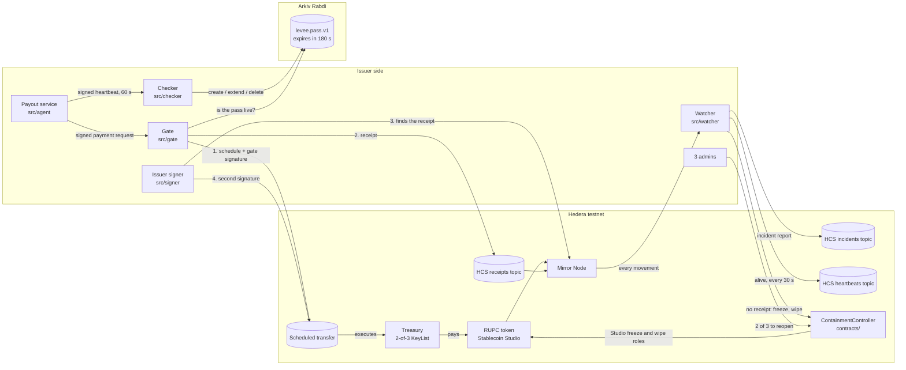

Levee is five small TypeScript services, one Solidity contract and a dashboard. Everything runs on Hedera testnet, and the machine passes live on Arkiv.

## The whole system

Read it in two halves:

- **Top path, a normal payment.** The payout service asks the gate. The gate checks the machine's pass on Arkiv, schedules the transfer with its own key and writes a receipt to HCS. The issuer signer finds that receipt on the Mirror Node and adds the second treasury signature. Only then does the money move.
- **Bottom path, the alarm.** The watcher reads every token movement from the Mirror Node and matches it to a receipt written before it. No receipt means a breach: it calls the ContainmentController, which freezes the treasury and wipes and freezes the receiver, and it publishes the incident to HCS. Only 2 of 3 admins can reopen.

## Where each part lives in the code

| Part | Folder | What it does |
|---|---|---|
| Gate | `src/gate/` | `decide.ts` holds the rules (caps, recipients, pass, watcher alive). `auth.ts` checks the machine's signature and role. `server.ts` schedules the transfer and writes the receipt |
| Issuer signer | `src/signer/` | `verify.ts` reads the schedule and the receipt from the Mirror Node. If they match exactly, `service.ts` adds the second signature |
| Watcher | `src/watcher/` | `match.ts` pairs each movement with a receipt. `contain.ts` calls the contract on a breach and writes the incident |
| Contract | `contracts/ContainmentController.sol` | Holds Stablecoin Studio's freeze and wipe roles. Can only close. Unfreeze, unpause and changing the watcher need 2 of 3 admins |
| Machine agent | `src/agent/` | Runs health checks on the payout machine, sends a signed heartbeat every 60 s and signs payment requests with the same key |
| Checker | `src/checker/` | Keeps one `levee.pass.v1` entity per machine on Arkiv. A good heartbeat extends it, a failing check deletes it |
| Shared | `src/shared/` | `hcs.ts` topics, `mirror.ts` cache-busted Mirror Node reads, `arkiv.ts` the pass schema, `rules.ts` the limits |
| Setup | `src/setup/` | Creates the accounts, the token through Stablecoin Studio, the three topics and the contract |
| Demo | `scripts/demo/` | `up.sh` starts every service. The runner drives Send, Hack, Unlock and Fake mint on the local dashboard |
| Dashboard | `dashboard/` | The landing page, the live board at `/live` and these docs |
| Tests | `tests/`, `dashboard/` | 351 core tests and 370 dashboard tests, run in GitHub CI |

## Why the parts are split this way

- **Two signatures from two processes.** The gate and the issuer signer each hold one treasury key. Stealing one is not enough to move money, and the signer only signs after it sees the receipt itself.
- **The alarm is separate from the gate.** If someone gets around the gate with stolen keys, the watcher still sees the money move on the Mirror Node.
- **The contract can only close.** A hacked watcher can stop payments but never release frozen funds.
- **Everything leaves a public record.** Receipts, incidents and heartbeats are HCS messages, so anyone can check the order from consensus timestamps.

For the step-by-step version, see [How it works](/how-it-works).
