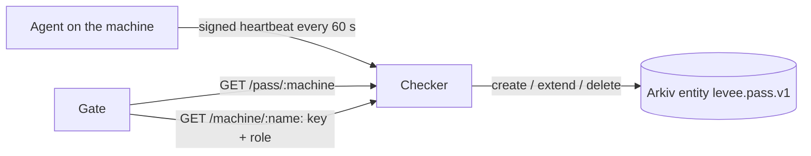

A company machine can ask for payments only while it holds a live **pass**, and only by signing the request with its own enrolled key. The pass is one Arkiv entity per machine. It expires 180 s after the machine's last good heartbeat.

The agent never judges transactions. It only says whether the machine is healthy.

## The rules

- **Silence means no pass.** A sleeping or offline machine stops heartbeating and its pass expires. That is reported as `offline`, never as a breach.
- **A failing check revokes at once.** The pass entity is deleted on Arkiv.
- **Only the checker can extend.** Entities are owned by the checker wallet and created with `permissionlessExtension: false`. A pass is live only if its owner is the checker wallet.
- **Fail closed.** If Arkiv is unreachable or its latest block is 10 s or older, no pass is live.
- **Heartbeats are signed** with the same machine key that signs payment requests. The checker rejects unknown, expired or replayed nonces, bad signatures, non-increasing sequence numbers and clock skew over 120 s.

## The 7 checks (macOS, read-only, no sudo)

| Check | Fails when |
|---|---|
| `persistence` | LaunchAgents or LaunchDaemons differ from the baseline |
| `remote-access` | AnyDesk, TeamViewer, RustDesk, ScreenConnect, Splashtop or Parsec is present |
| `ports` | Sensitive ports (22, 3389, 5900, 2375, 6379, 8888, 9222, 9229, 5432, 6443, 10250) listen beyond loopback |
| `devtools` | node, python3, git, npm or brew differ from the baseline hash |
| `protections` | Gatekeeper or SIP is off |
| `disk` | FileVault is off |
| `extensions` | A VS Code or Cursor extension was added in the last 24 h |

## Profiles

| Profile | Checks |
|---|---|
| `laptop` (default) | All 7 |
| `server`, `ci` | persistence, ports, devtools, protections |

The profile is fixed at enrolment. A laptop cannot later claim to be a server to skip checks.

## Live on Arkiv

The checker ran on the real Rabdi testnet during the Hedera live runs. The `payouts-server` pass [`0x13712f0c…b4d30ddd`](https://rabdi.explorer.arkiv.network/entity/0x13712f0cde60f187c6ba55fc4d4035911e0efa010fbb135fee7d1d6db4d30ddd) had 1 create and 42 extends. When the Mac went to sleep, nobody extended it, it expired, and the gate refused the remaining 107 payouts with `no-pass`. That is the expiry rule working with no revocation step.

## Limits

- Checks exist for macOS only.
- The checks are self-reported by the machine's own agent. A root-level attacker on that machine can lie to them and also holds the key that signs its requests. The pass raises the bar. It does not make a compromised machine trustworthy.
- Enrolment records (public key, role) live in the checker's local state, not on Arkiv.
