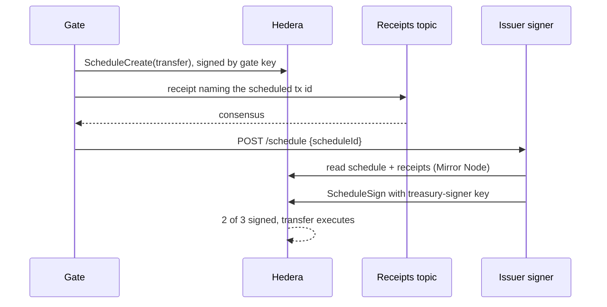

The treasury is a 2-of-3 KeyList: `{treasurySigner, gate, cold}`. A normal send needs two signatures. Levee gets them from two separate processes.

| Process | Key it holds |
|---|---|
| Gate | The gate key (key 2) and the receipts topic submit key |
| Issuer signer | Only the treasury-signer key (key 1) |
| Nobody online | The cold key (key 3) stays offline |

## The flow

## What the issuer signer checks

It signs only if all of these hold, read from the Mirror Node (`src/signer/verify.ts`):

1. The schedule was created by the gate account and is not deleted, executed or expired.
2. Its body is one plain token transfer of the token: treasury minus the amount, recipient plus the amount, nothing else.
3. A receipt for exactly that scheduled transaction id is on the receipts topic, paid by the gate, with the same token, from, to, amount and kind.
4. The caps and the recipient list still pass.

"No receipt yet" is re-checked every 0.75 s for up to `SIGNER_RECEIPT_WAIT_S` (default 60 s), then refused for good. Any other failure is refused at once. A refused schedule is never signed later by the same process.

The signer also polls the Mirror Node for schedules the gate created, every `SIGNER_POLL_S` (default 10 s). A schedule made with a stolen gate key and never announced is still judged, and refused if it has no receipt.

## Same transaction id

A scheduled transfer executes under the `ScheduleCreate`'s transaction id with the scheduled flag. The Mirror Node lists it under the same `transaction_id`, with `scheduled: true`. The gate fixes that id before writing the receipt, so the watcher matches scheduled transfers with no change.

## Live, 6 Nov 2026

- A signed send of 500 RUPC to Asha Pay: HTTP 200 in 8.9 s, matched, no breach. [Schedule](https://hashscan.io/testnet/schedule/0.0.11340805) · [receipt](https://hashscan.io/testnet/transaction/0.0.11333489-1793977081-963853491) · [sign](https://hashscan.io/testnet/transaction/0.0.11340800-1793977089-430366632) · [transfer](https://hashscan.io/testnet/transaction/0.0.11333489-1793977084-654477314).
- A gate-key schedule with no receipt: the signer looked for a receipt for 60 s, refused, and the schedule [0.0.11340812](https://hashscan.io/testnet/schedule/0.0.11340812) expired unexecuted.
- 5 transfers: 5 matched, 0 breaches. Gate reply p50 8.4 s.

## The cost

A scheduled send costs about 0.18 HBAR on testnet, against about 0.020 HBAR before. Almost all of it is the `ScheduleCreate` fixed fee. A send also takes longer: p50 8.4 s against 3.66 s before, mostly the signer waiting for the Mirror Node to serve the receipt.
