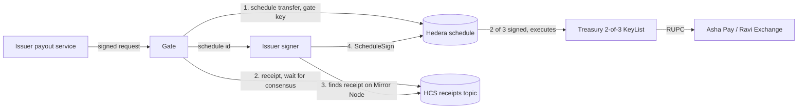
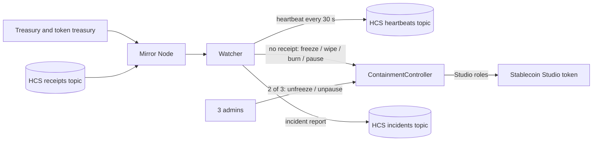
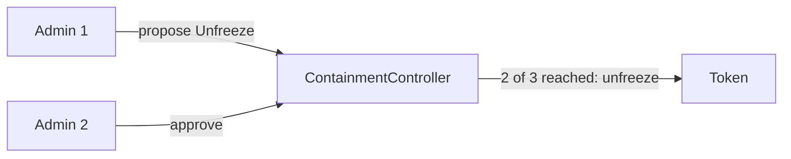

Levee is a few small parts. Each one does one job.

| Part | Job |
|---|---|
| **Gate** | Checks a payment request, schedules the transfer with its key and writes the receipt first |
| **Receipt** | An HCS message that names the exact transaction id of the transfer, written before it |
| **Issuer signer** | A separate process that adds the second treasury signature only after it finds the receipt on Hedera |
| **Watcher** | Reads every token movement and matches it to a receipt. No match is a breach |
| **ContainmentController** | A contract that holds the token's freeze, wipe, burn and pause roles. It can only close things |
| **Admins** | Three people. Any two can reopen |

## The normal path

1. The payout service sends a request signed with its enrolled machine key.
2. The gate checks who is asking, the machine's health pass, the caps, the recipient and that the watcher is alive.
3. The gate creates a Hedera scheduled transfer signed with its own key. That is one of the treasury's 2-of-3 keys.
4. The gate writes a receipt to the receipts topic naming the scheduled transaction id. It waits for consensus.
5. The issuer signer reads the schedule and the receipts topic from the Mirror Node. If the receipt matches exactly, it signs. Hedera executes the transfer on the second signature.

The schedule cannot execute before the signer signs, so the receipt always reaches consensus before the money moves.

## The watch and the response

The watcher reads every movement of the token on the Mirror Node. It matches each one by transaction id to a receipt that reached consensus before it. A movement with no receipt, a receipt written after it, a reused or mismatched receipt, a cap break, an unknown recipient, or a new allowance on the treasury is a breach.

On a breach the watcher calls the ContainmentController:

- Freeze the treasury, if tokens left it.
- Wipe and freeze an unknown receiver. A known partner is only frozen, never wiped.
- Burn unauthorised supply left in the token treasury.
- Pause the token, only if `PAUSE_ON_BREACH` is on.

The incident, with every step, its transaction id and its timing, is published to the incidents topic.

## Reopen

The watcher cannot reopen anything. Unfreeze, unpause and changing the watcher each need two different admins to approve the same proposal.

## The add-ons on the gate

These checks run before the gate signs. They are always on in today's code.

- Signed requests from an enrolled machine with an allowed role.
- A cap per payment and per day.
- Known recipients only.
- A machine health pass on Arkiv for the service that requests payments.
- A fresh watcher heartbeat. No watcher, no payments.

Read more in [Concepts](/concepts/receipts).
